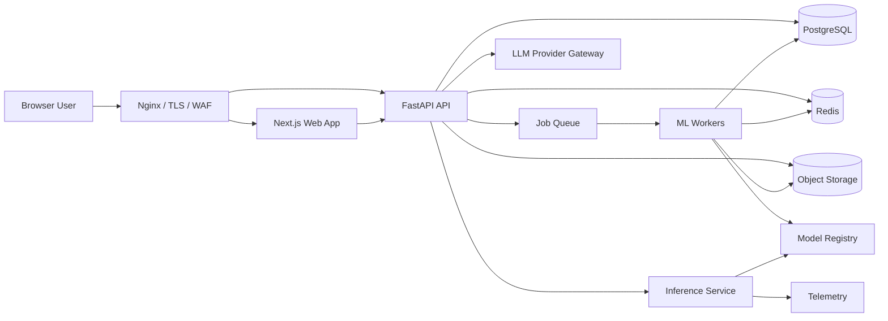
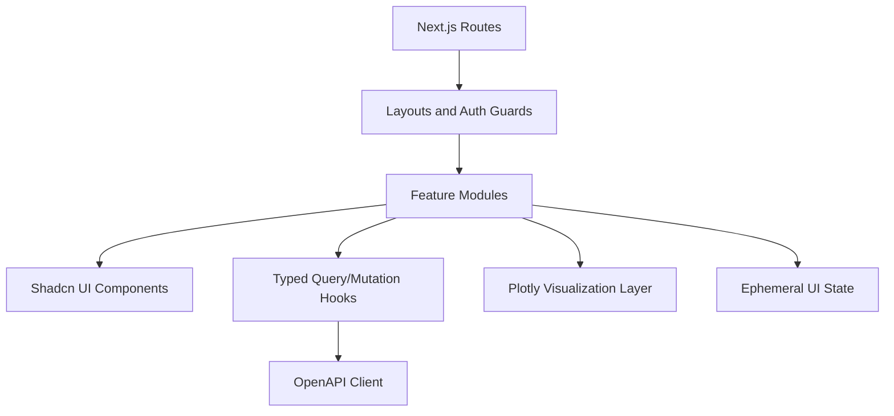
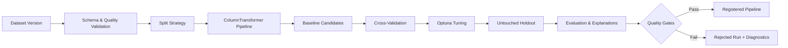
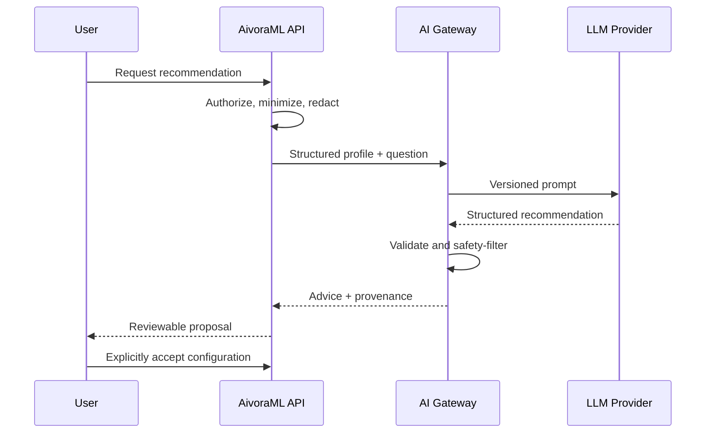
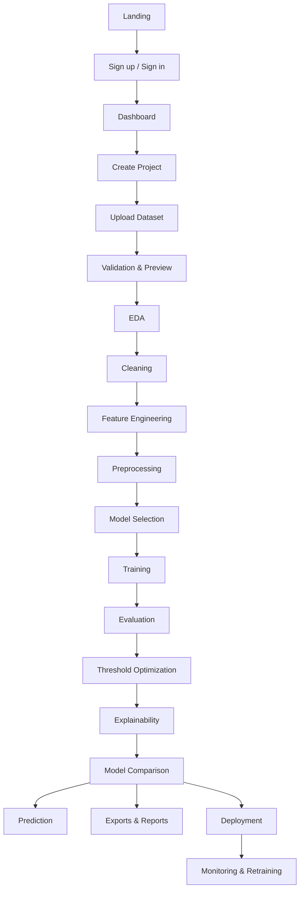
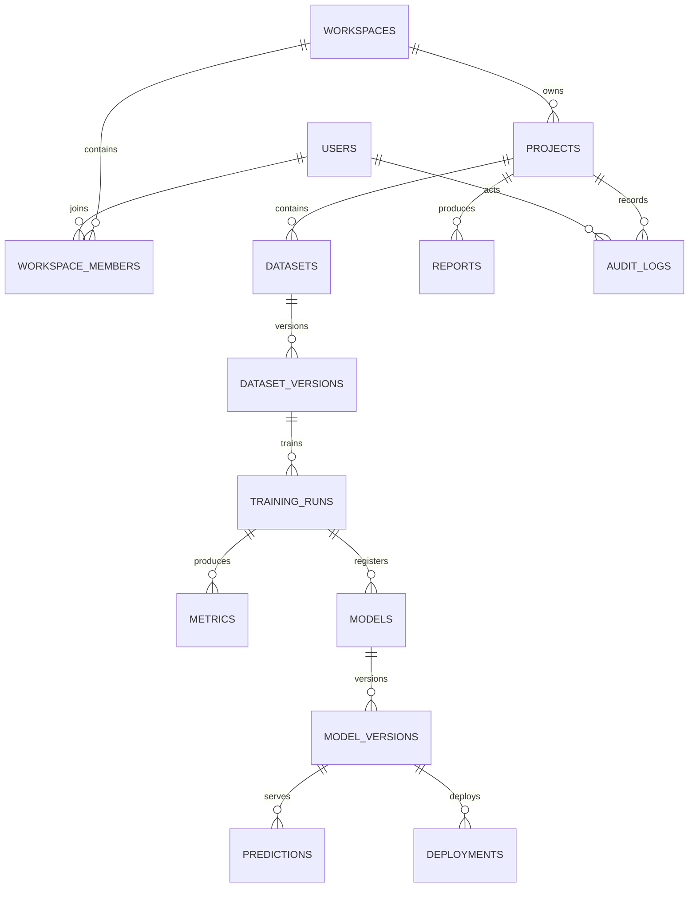

# AivoraML — Product Requirements, Technical Design, and Delivery Plan

**Document status:** Master plan  
**Product:** AivoraML AI-Powered Machine Learning Platform  
**Version:** 1.0  
**Last updated:** 2026-07-28  
**Owners:** Product, Engineering, Data Science, Security, and Operations  
**Audience:** Founders, product managers, designers, engineers, data scientists, QA, DevOps, security reviewers, and implementation partners

---

## Document Control

This document is the single source of truth for AivoraML's intended product behavior, target architecture, delivery sequence, and quality bar. Code and short-term tickets may implement only part of this plan; where they disagree with an approved architecture decision recorded here, the decision record takes precedence until amended.

### Status legend

| Mark | Meaning |
|---|---|
| ✅ Current | Implemented in the local-first prototype |
| 🟡 Partial | Implemented with material limitations |
| 🔵 Planned | Approved target-state capability |
| ⚪ Future | Outside the production-release baseline |

### Change procedure

1. Propose a change with rationale, alternatives, security impact, migration impact, and acceptance criteria.
2. Obtain product and technical approval.
3. Update affected requirements, diagrams, API contracts, data models, roadmap items, and architecture decisions.
4. Link implementation work to the changed section.
5. Record breaking changes in a versioned changelog.

---

## Table of Contents

1. [Project Overview](#1-project-overview)
2. [System Architecture](#2-system-architecture)
3. [Technology Stack](#3-technology-stack)
4. [Folder Structure](#4-folder-structure)
5. [Complete User Workflow](#5-complete-user-workflow)
6. [Feature Modules](#6-feature-modules)
7. [Machine Learning Workflow](#7-machine-learning-workflow)
8. [API Documentation](#8-api-documentation)
9. [Database Design](#9-database-design)
10. [Frontend Pages](#10-frontend-pages)
11. [UI Components](#11-ui-components)
12. [Machine Learning Models](#12-machine-learning-models)
13. [Evaluation Metrics](#13-evaluation-metrics)
14. [Explainability](#14-explainability)
15. [Reports and Exports](#15-reports-and-exports)
16. [Security](#16-security)
17. [Performance and Scalability](#17-performance-and-scalability)
18. [Testing Strategy](#18-testing-strategy)
19. [CICD and Release Management](#19-cicd-and-release-management)
20. [Logging and Monitoring](#20-logging-and-monitoring)
21. [Development Roadmap](#21-development-roadmap)
22. [Future Enhancements](#22-future-enhancements)
23. [Appendix](#23-appendix)

---

# 1. Project Overview

## 1.1 Identity

- **Project name:** AivoraML
- **Category:** AI-assisted end-to-end machine learning platform
- **Positioning:** A guided workspace that converts a tabular dataset and business objective into a validated, explainable, reproducible, and deployable ML solution.
- **Current state:** Single-user, local-first FastAPI prototype with a static web interface, tabular profiling, multi-model training, prediction, and artifact export.
- **Target state:** Secure multi-user web platform with project history, persistent metadata, asynchronous training, model registry, explainability, reports, and managed deployment.

## 1.2 Vision

Make trustworthy machine learning accessible without hiding the decisions that determine model quality. AivoraML should reduce routine work while teaching users what happened, why it happened, and what risks remain.

## 1.3 Mission

Provide one coherent workflow for dataset ingestion, quality analysis, preprocessing, experiment design, training, evaluation, explanation, inference, export, deployment, and monitoring. Automation must remain reproducible, leakage-safe, reviewable, and overridable.

## 1.4 Objectives and measurable outcomes

| Objective | Product measure | Initial production target |
|---|---|---|
| Reduce time to a defensible baseline | Median time from valid upload to evaluated model | Under 10 minutes for ≤100k rows and ≤100 columns |
| Improve reproducibility | Runs containing dataset, configuration, code/dependency, and seed metadata | 100% |
| Prevent common ML errors | Runs passing leakage, split, schema, and metric checks | 100% before registration |
| Make results understandable | Successful report generation with model card and explanations | ≥99% of completed runs |
| Enable reliable inference | Valid prediction requests meeting the saved feature contract | ≥99.9% server success excluding invalid input |
| Maintain user trust | Destructive or irreversible automated decisions | None without explicit confirmation |

## 1.5 Problems solved

1. Tool fragmentation across notebooks, scripts, dashboards, model files, and deployment systems.
2. Inconsistent preprocessing between training and inference.
3. Data leakage caused by preprocessing before data splitting or cross-validation.
4. Metric misuse, especially accuracy on imbalanced data and aggregate scores without uncertainty.
5. Manual, undocumented experiment comparison.
6. Limited explainability for non-specialists.
7. Lost lineage between source data, transformations, model artifacts, and predictions.
8. Slow handoff from experimentation to a testable inference service.
9. Repetitive boilerplate for EDA, validation, reports, and notebooks.

## 1.6 Target users

| Persona | Needs | AivoraML value |
|---|---|---|
| Analyst | Guided modeling without infrastructure work | Safe defaults, explanations, downloadable outputs |
| Data scientist | Faster baselines and repeatable experiments | Configurable pipelines, comparisons, tuning, lineage |
| ML engineer | Deployable, validated artifacts | Versioned pipelines, schemas, APIs, monitoring hooks |
| Product/domain expert | Understand trade-offs and predictions | Business-oriented metrics, threshold tools, reports |
| Educator/student | Learn a complete workflow | Transparent stages, generated notebook, terminology |
| Administrator | Control risk, access, cost, and retention | RBAC, quotas, audit logs, lifecycle policies |

## 1.7 Business value

- Shortens experimentation cycles and reduces specialist bottlenecks.
- Creates a reusable record of data and model decisions.
- Reduces production incidents caused by schema mismatch and preprocessing drift.
- Supports freemium local use, managed team workspaces, and enterprise governance tiers.
- Enables usage-based revenue for hosted training, storage, deployments, and AI assistance.

## 1.8 Key features

- Secure account and workspace management.
- Dataset upload, validation, preview, versioning, and profiling.
- Automatic task and target suggestions with confidence and rationale.
- Interactive EDA, missingness, outlier, imbalance, and correlation analysis.
- Configurable cleaning, feature engineering, encoding, imputation, scaling, and selection.
- Leakage-safe model comparison, cross-validation, tuning, and final holdout evaluation.
- Classification threshold optimization and calibration analysis.
- Global and local explanations using native importance, permutation importance, SHAP, LIME, and partial dependence.
- Single and batch prediction with strict schema validation.
- Notebook, HTML, PDF, JSON, CSV, model, preprocessor, and project exports.
- Model registry, deployment, endpoint keys, monitoring, rollback, and retraining.
- Optional AI copilot that explains and recommends but does not silently change experiments.

## 1.9 Scope

### Production-release scope

- Supervised classification and regression for structured/tabular data.
- CSV, XLS/XLSX, JSON, and Parquet ingestion.
- Datasets within published tenant quotas.
- Browser application, REST API, asynchronous workers, relational metadata, object artifacts, and Redis-backed task/cache services.
- Reproducible preprocessing and scikit-learn-compatible pipelines.
- Batch and low-volume online inference.
- English user interface and documentation.

### Explicitly out of scope for the first production release

- Computer vision, audio, video, and large-scale NLP foundation-model training.
- Unbounded distributed training.
- Fully autonomous feature or deployment changes.
- Regulated-use certification.
- Guaranteed causal inference.
- Arbitrary user code execution outside an isolated future sandbox.

## 1.10 Future scope

AutoML policy search, time-series forecasting, clustering, anomaly detection, distributed/cloud training, collaborative notebooks, RAG over project artifacts, enterprise SSO, private networking, experiment tracking integrations, feature stores, real-time drift monitoring, and a marketplace of reusable pipeline templates.

## 1.11 Product principles

1. **Evidence before recommendation.**
2. **Reproducibility by default.**
3. **Training/inference parity.**
4. **Human approval for consequential actions.**
5. **Clear separation of measured facts, heuristics, and AI-generated advice.**
6. **Secure tenant isolation and least privilege.**
7. **Useful local mode without a paid AI provider.**

---

# 2. System Architecture

## 2.1 Overall target architecture

AivoraML uses a modular web architecture. The browser communicates with a versioned API. FastAPI handles synchronous validation and orchestration; workers execute expensive profiling, training, explanation, and report jobs. PostgreSQL stores transactional metadata, object storage holds immutable dataset/model/report artifacts, and Redis provides caching, rate-limit counters, locks, and job coordination.



## 2.2 Architectural boundaries

| Boundary | Responsibility | Must not do |
|---|---|---|
| Web client | Presentation, interaction state, accessible visualization | Hold secrets or trust client-side authorization |
| API | Authentication, authorization, validation, orchestration, contracts | Perform long CPU-bound training in request threads |
| Domain/ML engine | Pure pipeline decisions and computations | Depend on HTTP or UI details |
| Worker | Execute idempotent jobs with resource limits | Invent ownership or bypass project access checks |
| Metadata store | Transactional state, relationships, audit references | Store large raw artifacts |
| Object store | Versioned binary/tabular artifacts | Act as the authorization source of truth |
| AI gateway | Prompt policy, redaction, provider calls, provenance | Train or deploy models without explicit workflow approval |

## 2.3 Frontend architecture

- Next.js App Router provides route layouts, server rendering for public pages, and authenticated application shells.
- React components are divided into page features, shared UI primitives, visualization adapters, and typed API hooks.
- TypeScript strict mode, generated OpenAPI types, TanStack Query for server state, and local state only for ephemeral interactions.
- Tailwind CSS and Shadcn UI provide tokens and accessible primitives.
- Large tables use virtualization; charts load lazily and expose accessible summaries.
- Uploads use signed multipart URLs when object storage is enabled.



## 2.4 Backend architecture

The backend follows presentation, application, domain, and infrastructure layers:

- **Routers:** HTTP contracts, status codes, dependency injection.
- **Application services:** use-case orchestration and transaction boundaries.
- **Domain services:** profiling, transformations, evaluation, recommendation rules.
- **Repositories:** SQLAlchemy data access scoped by tenant.
- **Artifact services:** object-store keys, checksums, retention, signed access.
- **Job services:** enqueue, cancellation, progress, retries, idempotency.
- **Policy services:** authorization, quotas, validation, feature flags.

## 2.5 ML engine architecture



All learned preprocessing is fitted inside each training fold. The final holdout is accessed once after selection. Every run records data version, target, feature contract, split indices or deterministic split recipe, random seed, transformations, candidate set, parameters, metrics, warnings, package versions, source revision, and artifact checksums.

## 2.6 Database architecture

PostgreSQL is authoritative for identities, permissions, project metadata, run state, metrics, lineage, deployments, and audit events. Tables use UUID primary keys, UTC timestamps, soft deletion where recovery is required, optimistic version fields for concurrent edits, and tenant/project indexes. JSONB is permitted for bounded algorithm configuration and metric payloads, not as a substitute for core relationships.

## 2.7 API architecture

- Base prefix: `/api/v1`.
- OpenAPI 3 contract generated by FastAPI.
- JSON uses `snake_case`; timestamps use ISO 8601 UTC.
- Cursor pagination for mutable collections.
- Standard error envelope: `code`, `message`, `details`, `request_id`.
- `Idempotency-Key` required for create-run, deploy, and other retryable mutations.
- Long work returns `202 Accepted` with a job resource.
- Breaking changes require a new major API version.

## 2.8 File storage architecture

```text
tenant/{tenant_id}/
  projects/{project_id}/
    datasets/{dataset_id}/versions/{version_id}/{checksum}.{ext}
    runs/{run_id}/artifacts/{artifact_type}/{checksum}
    models/{model_id}/versions/{version_id}/pipeline.joblib
    reports/{report_id}/{format}/{checksum}
```

Artifacts are private, encrypted, checksum-verified, malware-scanned where applicable, and accessed through short-lived signed URLs. Database rows retain content type, size, checksum, owner, lineage, retention state, and encryption metadata. Local development maps the same interface to `storage/`.

## 2.9 AI workflow architecture

The AI assistant receives a minimal structured project summary, not unrestricted files. The gateway redacts sensitive samples, applies prompt templates and token budgets, records provider/model/template version, and validates structured output. Advice is labeled as AI-generated and never becomes an experiment configuration until accepted by the user.



## 2.10 Availability and consistency

- Metadata mutations are strongly consistent within PostgreSQL transactions.
- Artifact upload is finalized only after checksum verification; orphan cleanup is asynchronous.
- Job handlers are idempotent and use leases to avoid double completion.
- Target production objective: 99.9% monthly availability for API/inference, excluding scheduled maintenance.
- Recovery objectives: RPO ≤15 minutes and RTO ≤4 hours for production metadata; immutable artifact replicas follow storage-tier policy.

---

# 3. Technology Stack

| Area | Technology | Selection rationale |
|---|---|---|
| Frontend | Next.js | Routing, server rendering, layouts, build optimization, and mature deployment model |
| Frontend | React | Component composition and broad visualization/form ecosystem |
| Frontend | TypeScript | Compile-time API and component contracts; safer refactoring |
| Styling | Tailwind CSS | Token-driven, consistent UI without large bespoke stylesheets |
| Components | Shadcn UI | Accessible, owned source primitives that remain customizable |
| API | FastAPI | Async Python API, dependency injection, Pydantic integration, OpenAPI generation |
| Language | Python | Dominant ML ecosystem and strong data-processing libraries |
| Validation | Pydantic | Typed, explicit request/config validation and serialization |
| ORM | SQLAlchemy + Alembic | Transactional data layer, migrations, PostgreSQL support |
| Core ML | Scikit-learn | Stable pipeline abstractions, preprocessing, metrics, broad baselines |
| Boosting | XGBoost | Strong tabular baseline, regularization, CPU/GPU options |
| Boosting | LightGBM | Efficient histogram training for larger tabular datasets |
| Boosting | CatBoost | Strong native treatment of categorical variables |
| Explainability | SHAP | Global/local additive explanations for supported models |
| Explainability | LIME | Model-agnostic local explanation fallback |
| Tuning | Optuna | Pruning, conditional search spaces, persistent studies |
| Visualization | Plotly | Interactive browser-native EDA and metric charts |
| Visualization | Matplotlib/Seaborn | Static report and notebook visualizations |
| Database | PostgreSQL | Reliable relational transactions, JSONB, indexing, mature operations |
| Coordination | Redis | Cache, job broker, locks, progress, and rate limits |
| Browser/local | Local Storage | Non-sensitive UI preferences only; never tokens or authoritative data |
| Artifacts | S3-compatible object storage | Durable, scalable, versioned binary storage with signed URLs |
| Jobs | Celery, Dramatiq, or equivalent | Isolated background execution and retry semantics; select by ADR |
| Packaging | Docker | Reproducible services and controlled native dependencies |
| CI/CD | GitHub Actions | Repository-integrated checks, artifacts, environments, approvals |
| Edge | Nginx | TLS termination, routing, compression, upload limits, security headers |
| Cloud | Managed PostgreSQL/Redis/object store + containers | Reduce operational burden while retaining portability |

### Technology constraints

- Pin production dependencies through a lock/constraints strategy and scan them continuously.
- Serialize only trusted server-created model artifacts; never unpickle user uploads.
- GPU support is optional and isolated into compatible worker pools.
- AI providers are accessed through an abstraction so local deterministic workflows remain available.

---

# 4. Folder Structure

## 4.1 Current repository

```text
project/
├── assets/                   # Design and QA reference images
├── backend/
│   ├── __init__.py
│   ├── main.py               # Current FastAPI routes and local orchestration
│   ├── schemas.py            # Current Pydantic contracts
│   ├── requirements.txt
│   └── services/
│       ├── ai_advisor.py
│       ├── dataset_profiler.py
│       ├── eda_generator.py
│       ├── ml_engine_enhanced.py
│       └── notebook_generator_pro.py
├── data/                     # Local source datasets; ignored except marker
├── docs/
│   ├── ARCHITECTURE.md
│   └── PROJECT_PLAN.md
├── frontend/                 # Current static HTML, CSS, and JavaScript UI
├── models/                   # Generated model artifacts
├── notebooks/                # Exploratory and exported notebooks
├── outputs/                  # Generated charts and reports
├── scripts/
│   └── start_server.bat
├── src/                      # Reserved for extracted reusable domain package
├── storage/                  # Current private local workspace state
├── tests/                    # End-to-end smoke suite
├── venv/                     # Local, ignored Python environment
├── .env.example              # Safe configuration template
├── .gitignore
├── README.md
└── START_AIVORAML.bat
```

## 4.2 Target repository

```text
project/
├── apps/
│   ├── web/                  # Next.js application
│   │   ├── app/              # Route groups, layouts, loading/error boundaries
│   │   ├── components/       # Feature components
│   │   ├── lib/              # API client, auth, formatting, validation
│   │   ├── public/
│   │   └── tests/
│   └── api/                  # FastAPI transport/application layer
│       ├── api/v1/routers/
│       ├── core/             # Config, auth, logging, middleware
│       ├── repositories/
│       └── services/
├── src/aivoraml/
│   ├── domain/               # Framework-independent entities and policies
│   ├── data/                 # Validation, profiling, transformations
│   ├── ml/                   # Splits, pipelines, candidates, metrics, tuning
│   ├── explainability/
│   ├── reporting/
│   └── storage/              # Artifact-store interfaces
├── workers/                  # Job entry points and queue configuration
├── migrations/               # Alembic migrations
├── infrastructure/
│   ├── docker/
│   ├── nginx/
│   ├── terraform/            # Optional cloud infrastructure
│   └── monitoring/
├── tests/
│   ├── unit/
│   ├── integration/
│   ├── contract/
│   ├── ml/
│   ├── security/
│   ├── performance/
│   └── e2e/
├── scripts/                  # Repeatable setup, data, migration, and release tasks
├── docs/                     # Plan, ADRs, runbooks, API and security docs
├── data/ models/ outputs/ notebooks/ storage/ assets/
├── pyproject.toml            # Python build/tool configuration
├── package.json              # Workspace scripts if using a JS monorepo
├── compose.yaml              # Local multi-service environment
└── .github/workflows/        # CI/CD pipelines
```

Every package must expose a narrow public interface. Generated data, secrets, environments, model binaries, and runtime logs must remain untracked.

---

# 5. Complete User Workflow



1. **Landing:** User learns supported workflows, security posture, examples, pricing, and limitations; CTA starts a demo or account creation.
2. **Authentication:** Email/password or configured identity provider. Verification, MFA policy, consent, and recovery are explicit.
3. **Dashboard:** Shows recent projects, running jobs, deployed models, quota use, failures requiring attention, and onboarding actions.
4. **Create project:** User supplies name, description, business objective, visibility, retention, and optional target/task hints.
5. **Upload:** Drag-and-drop or select a supported file. UI displays size/type limits, progress, cancellation, checksum, and scan/validation status.
6. **Preview:** Shows schema, sample rows, inferred semantic types, missing values, duplicates, identifier risks, target suggestions, and blocking errors. Users may correct types.
7. **EDA:** Interactive distributions, correlations, target relationships, imbalance, outliers, leakage warnings, and downloadable findings.
8. **Cleaning:** Recommended actions are proposed with impact counts and before/after preview. Users approve, change, reorder, or disable them.
9. **Feature engineering:** Date decomposition, ratios, text/category handling, transformations, interactions, and leakage review. Every feature has lineage.
10. **Preprocessing:** Configure imputers, encoders, scalers, rare-category rules, and feature selection. UI warns about incompatible choices.
11. **Model selection:** AivoraML recommends candidate families using task, sample size, sparsity, dimensionality, interpretability, latency, and imbalance constraints.
12. **Training:** User selects Fast, Balanced, or Thorough budget—or advanced controls—then starts an asynchronous run with live stage progress and cancellation.
13. **Evaluation:** Compare cross-validation and untouched-holdout metrics, confidence intervals, confusion/residual diagnostics, calibration, timing, and generalization gap.
14. **Threshold optimization:** For probabilistic classification, choose an objective or cost matrix and preview trade-offs without retraining.
15. **Explainability:** Review global drivers, local explanations, dependence behavior, stability caveats, and subgroup behavior.
16. **Comparison:** Compare runs using a consistent dataset version and holdout; flag invalid cross-version comparisons.
17. **Prediction:** Enter a validated row or upload a batch. Display prediction, probability/interval when supported, explanation, model version, and input warnings.
18. **Export:** Generate pipeline, notebook, model card, metrics, cleaned dataset, HTML/PDF report, and reproducibility manifest.
19. **Deployment:** Select an approved model version, environment, scaling limits, and access policy. Complete smoke test before traffic.
20. **Monitoring:** Inspect latency, errors, traffic, input drift, prediction drift, delayed ground-truth performance, and retraining recommendations.

### Workflow-wide UX requirements

- Users can leave and resume every durable step.
- Long operations show stage, percentage when meaningful, elapsed time, logs summary, and cancellation.
- Recommendations expose rationale, confidence, and consequences.
- Destructive changes create a new version rather than mutating prior artifacts.
- Every screen includes loading, empty, permission-denied, recoverable-error, and terminal-error states.

---

# 6. Feature Modules

| Module | Detailed behavior | Acceptance criteria |
|---|---|---|
| Dataset upload | Multipart/direct-to-object-store upload, checksum, extension/MIME validation, quotas, scan, idempotency | Unsupported, oversized, corrupt, or malicious files are rejected without persistence |
| Dataset validation | Parse schema, encoding, row/column limits, duplicate headers, empty data, type consistency, target validity | Produces blocking errors, warnings, and machine-readable profile |
| Problem detection | Suggest classification/regression and candidate targets using dtype/cardinality/name/distribution heuristics | Suggestions include score and rationale; user confirmation required |
| EDA | Numeric/categorical summaries, histograms, target relationships, missingness, correlation, imbalance, cardinality | Computations are deterministic for a dataset version and sampled views are labeled |
| Missing values | Per-cell/row/column analysis and mechanism-oriented warnings; imputation preview | Learned imputers fit only on training folds |
| Outliers | IQR, robust-z, isolation-based optional detection; mark, cap, transform, or retain | Impact count and target leakage risk shown before application |
| Correlation | Pearson/Spearman/Cramér's V or suitable associations; multicollinearity warnings | Constant columns and missingness handled explicitly |
| Cleaning | Duplicate removal, type coercion, invalid-value rules, target-null handling | Transformation recipe is ordered, versioned, reversible by version |
| Feature engineering | Date parts, log/power transforms, interactions, frequency encoding, grouped rare values | New features retain source lineage and inference implementation |
| Encoding | One-hot, ordinal, target encoding where leakage-safe, native categorical path | Unknown inference categories do not crash configured pipelines |
| Scaling | Standard, robust, min-max, or none based on model family | Scaling is applied only when useful and fitted inside pipeline |
| Imputation | Median/mean/constant/KNN/iterative options under resource policy | Strategy recorded per feature group |
| Feature selection | Variance, correlation, univariate, model-based, permutation, optional RFE | Selection occurs within CV when learned from target |
| Recommendation | Rank model families by data and operational constraints | User sees reasons, exclusions, expected trade-offs—not guaranteed scores |
| Training | Baselines and selected candidates, deterministic splits, progress, cancellation | Completed run has full provenance and serialized fitted pipeline |
| Tuning | Optuna study with bounded spaces, pruning, timeout/trial budget | Validation objective only; holdout never optimizes parameters |
| Cross-validation | Stratified/KFold/group/time-aware strategy according to data | Fold choice and leakage assumptions recorded |
| Threshold optimization | Objective, constraints, or cost matrix over validation/out-of-fold predictions | Final threshold and curve retained independently of model weights |
| Evaluation | Task-specific metrics, uncertainty, diagnostic plots, subgroup slices | Primary metric declared before final holdout access |
| Explainability | Native, permutation, SHAP, LIME, PDP with sampling and caveats | Explanation identifies model/data version and method configuration |
| Comparison | Side-by-side runs and Pareto view for quality, latency, size, interpretability | Warns on different datasets, splits, or metric definitions |
| Prediction | Strict schema, coercion rules, single/batch modes, provenance | Unknown/missing required fields return field-level errors |
| Notebook generator | Executable notebook recreating load, validation, pipeline, training, evaluation | Notebook validates and all generated code parses |
| PDF/HTML reports | Branded, accessible executive and technical views | Server-side generation is deterministic and stored with checksum |
| Export pipeline | Pipeline, schema, requirements, manifest, sample invocation | Export passes isolated load and sample-inference test |
| Deployment | Register, approve, deploy, health-check, scale, rotate keys, rollback | Only approved compatible artifacts can receive traffic |
| Project history | Timeline of uploads, transformations, runs, reports, predictions, deployments | Events are attributable and filterable |
| Versioning | Immutable dataset/model/report versions with lineage graph | Prior versions remain reproducible until retention expiry |

---

# 7. Machine Learning Workflow

## 7.1 Lifecycle

1. **Problem identification:** Record outcome, unit of prediction, decision timing, acceptable errors, latency, interpretability, fairness, and ground-truth availability.
2. **Data collection:** Create immutable dataset version with checksum, origin, owner, license/sensitivity tags, and collection time.
3. **EDA:** Inspect schema, target, distributions, associations, duplicates, leakage candidates, and subgroup coverage.
4. **Cleaning:** Define deterministic transformations; drop target-null rows only with recorded counts.
5. **Feature engineering:** Generate only features available at prediction time.
6. **Feature selection:** Remove identifiers, constants, duplicates, leakage, and optionally learned low-value features within folds.
7. **Split:** Choose random stratified, grouped, temporal, or custom strategy. Reserve final holdout.
8. **Cross-validation:** Estimate selection performance and uncertainty on training partition.
9. **Baselines:** Include trivial dummy baseline and interpretable linear/tree baseline.
10. **Model selection:** Compare declared primary metric plus operational constraints.
11. **Tuning:** Search only training/CV data with bounded compute.
12. **Evaluation:** Lock candidate; evaluate once on holdout; produce diagnostics and uncertainty.
13. **Threshold/calibration:** Use validation or out-of-fold predictions; confirm on holdout without iterative peeking.
14. **Explainability:** Generate global/local evidence and stability warnings.
15. **Saving pipeline:** Serialize preprocessor + estimator + decision threshold + feature contract and manifest.
16. **Inference:** Apply exact saved schema and pipeline; log version and latency.
17. **Deployment:** Promote approved artifact across environments with rollback.
18. **Monitoring:** Track service health, drift, and performance when labels arrive.
19. **Retraining:** Trigger by schedule, drift, performance, or approved request; create a new version.

## 7.2 Leakage controls

- No target-derived transformations outside training folds.
- Group entities cannot cross folds when repeated observations exist.
- Temporal splits respect prediction time and feature availability time.
- Oversampling occurs only inside training folds.
- Feature selection and imputation are pipeline steps.
- Final holdout results are immutable and tagged with access count.
- AI recommendations cannot access hidden holdout labels.

## 7.3 Reproducibility manifest

Each run stores: project/dataset version, checksum, source revision, Python and dependency versions, OS/architecture, random seeds, split strategy, fold indices or hashes, feature schema, transformation graph, candidates, search space, trials, metrics, threshold, warnings, timestamps, compute profile, artifact checksums, and parent run.

## 7.4 Quality gates

- Dataset and target pass validation.
- Dummy baseline included.
- No leakage check failures.
- Finite primary metric from at least two valid folds.
- Holdout never used for candidate selection.
- Saved pipeline successfully reloads in an isolated process.
- Prediction schema test passes.
- Model card documents intended use, limitations, data, metrics, and risks.

---

# 8. API Documentation

## 8.1 Contract conventions

Authentication uses `Authorization: Bearer <access-token>` or scoped deployment API keys. Create/update endpoints validate tenant ownership, schemas, state transitions, quotas, and idempotency. Common errors: `400 invalid_request`, `401 unauthenticated`, `403 forbidden`, `404 not_found`, `409 conflict`, `413 payload_too_large`, `422 validation_failed`, `429 rate_limited`, and `500 internal_error`.

## 8.2 Target API endpoints

Every response includes `request_id`; every list supports cursor pagination where relevant.

### Authentication and users

| Method / URL | Request | Success response | Validation | Domain errors |
|---|---|---|---|---|
| `POST /api/v1/auth/register` | email, password, name, terms version | `201` user + verification state | normalized email; strong breached-password check | email exists, registration disabled |
| `POST /api/v1/auth/login` | email, password, MFA code if required | access/refresh tokens + user | rate limit; verified credentials | invalid credentials, locked account |
| `POST /api/v1/auth/refresh` | refresh token | rotated token pair | active non-reused token | revoked/replayed token |
| `POST /api/v1/auth/logout` | refresh token/all-sessions flag | `204` | token ownership | already revoked is idempotent |
| `POST /api/v1/auth/password/forgot` | email | `202` | rate limit | never reveals account existence |
| `POST /api/v1/auth/password/reset` | reset token, new password | `204` | token expiry, password policy | invalid/used token |
| `GET/PATCH /api/v1/users/me` | profile/settings fields on PATCH | user profile | field and locale validation | stale version conflict |

### Projects and datasets

| Method / URL | Request | Success response | Validation | Domain errors |
|---|---|---|---|---|
| `GET/POST /api/v1/projects` | filters or name, objective, visibility | page or `201` project | quota, unique active name | quota exceeded |
| `GET/PATCH/DELETE /api/v1/projects/{id}` | editable fields/version or confirmation | project/`204` | role, optimistic version | active deployment, conflict |
| `GET /api/v1/projects/{id}/history` | cursor, event filters | event page | project access | project not found |
| `POST /api/v1/projects/{id}/datasets/uploads` | filename, size, content type, checksum | upload session/signed parts | type, size, quota | unsupported file |
| `POST /api/v1/datasets/{id}/uploads/complete` | parts, checksum | `202` validation job | complete upload, checksum | corrupt/incomplete upload |
| `GET /api/v1/projects/{id}/datasets` | cursor | dataset/version page | access | none |
| `GET /api/v1/datasets/{id}` | — | metadata and latest version | access | missing/deleted |
| `GET /api/v1/dataset-versions/{id}/preview` | columns, offset/limit | typed rows and schema | bounded preview | parse unavailable |
| `GET /api/v1/dataset-versions/{id}/profile` | — | quality profile | completed validation | profile pending/failed |
| `POST /api/v1/dataset-versions/{id}/transformations` | ordered transformation recipe | `202` derived-version job | operation schemas, lineage | invalid target/type |
| `GET /api/v1/dataset-versions/{id}/download` | format | signed URL/stream | format, permission | artifact expired |

### EDA, training, evaluation, and explainability

| Method / URL | Request | Success response | Validation | Domain errors |
|---|---|---|---|---|
| `POST /api/v1/dataset-versions/{id}/eda` | target, chart/analysis options | `202` EDA job | target exists; budget | unsupported analysis |
| `GET /api/v1/eda-runs/{id}` | — | status, findings, artifacts | ownership | pending/failed |
| `POST /api/v1/projects/{id}/training-runs` | dataset version, target, task, split, preprocessing, models, budget, metric | `202` run + job | full config, quota, idempotency | incompatible config |
| `GET /api/v1/training-runs/{id}` | — | state, progress, provenance, summary | access | missing |
| `POST /api/v1/training-runs/{id}/cancel` | reason | accepted state | cancellable state | already terminal |
| `GET /api/v1/training-runs/{id}/metrics` | fold/split filters | metric set and uncertainty | completed stages | metrics unavailable |
| `GET /api/v1/training-runs/{id}/artifacts` | type filter | artifact metadata | access | artifact expired |
| `POST /api/v1/training-runs/{id}/thresholds` | objective, constraints/cost matrix | threshold analysis | classification probabilities | unsupported estimator |
| `POST /api/v1/training-runs/{id}/explanations` | method, scope, sample policy | `202` explanation job | method compatibility, budget | unsupported/too large |
| `GET /api/v1/explanations/{id}` | — | status, values, plots, caveats | access | failed explanation |
| `POST /api/v1/projects/{id}/comparisons` | run IDs, metrics | comparison view | compatible lineage/metrics | incomparable runs |

### Models, predictions, reports, deployment, and settings

| Method / URL | Request | Success response | Validation | Domain errors |
|---|---|---|---|---|
| `POST /api/v1/training-runs/{id}/models` | name, stage, approval note | `201` registered version | quality gates, permission | gates failed |
| `GET /api/v1/models/{id}/versions/{version}` | — | model card and lineage | access | missing version |
| `GET /api/v1/model-versions/{id}/schema` | — | ordered inference schema | model compatibility | artifact unavailable |
| `POST /api/v1/model-versions/{id}/predict` | values, explanation flag | prediction, probabilities/interval, version | strict feature schema | invalid fields |
| `POST /api/v1/model-versions/{id}/batch-predictions` | dataset version/upload, output options | `202` job | schema and quota | incompatible columns |
| `GET /api/v1/prediction-jobs/{id}` | — | progress and output artifact | access | failed job |
| `POST /api/v1/projects/{id}/reports` | source runs, format, sections | `202` report job | compatible sources | renderer failure |
| `GET /api/v1/reports/{id}` | — | metadata + signed download | access/retention | expired |
| `POST /api/v1/model-versions/{id}/exports` | formats/options | `202` export job | format compatibility | unsafe export |
| `POST /api/v1/model-versions/{id}/deployments` | environment, resources, access policy | `202` deployment | approval, quota, idempotency | incompatible artifact |
| `GET/PATCH/DELETE /api/v1/deployments/{id}` | scaling/traffic/version or confirmation | deployment/`204` | role, transition | active requests/conflict |
| `POST /api/v1/deployments/{id}/rollback` | target version, reason | `202` rollout | healthy prior version | unavailable target |
| `GET /api/v1/deployments/{id}/metrics` | time range, resolution | service/model telemetry | bounded range | telemetry unavailable |
| `GET/PATCH /api/v1/settings/workspace` | settings/version | workspace settings | admin role, ranges | conflict |

### Jobs and audit

| Method / URL | Request | Success response | Validation | Domain errors |
|---|---|---|---|---|
| `GET /api/v1/jobs/{id}` | — | state, progress, timestamps, error summary | resource ownership | job missing |
| `POST /api/v1/jobs/{id}/retry` | reason | new job ID | retryable terminal state | retry limit |
| `GET /api/v1/audit-logs` | actor/action/resource/time filters | immutable event page | auditor/admin role | invalid range |

## 8.3 Current prototype API

The present application exposes unversioned local endpoints for upload/demo, dataset profile and imbalance, current project, workflow execution, professional training, prediction/schema/history, model/preprocessor/notebook/dataset/metrics/project downloads, AI recommendations/explanations/status, and a debug dataset route. These remain local-only compatibility endpoints until the `/api/v1` migration. Authentication, relational persistence, background jobs, reports, and deployment endpoints are not yet implemented.

---

# 9. Database Design

## 9.1 Entity relationship diagram



## 9.2 Core tables

| Table | Important columns | Constraints and indexes |
|---|---|---|
| `users` | id, email, password_hash, name, status, email_verified_at, mfa_state, last_login_at, created_at | unique normalized email; no plaintext credentials |
| `workspaces` | id, name, plan, settings_json, retention_days, version | plan/retention checks |
| `workspace_members` | workspace_id, user_id, role, joined_at | composite unique; role enum |
| `projects` | id, workspace_id, name, objective, status, created_by, version, deleted_at | unique active name per workspace; tenant/status indexes |
| `datasets` | id, project_id, name, source_type, created_by | project/name index |
| `dataset_versions` | id, dataset_id, parent_id, artifact_id, checksum, format, rows, columns, schema_json, profile_json, state | unique dataset/checksum; immutable after ready |
| `training_runs` | id, project_id, dataset_version_id, target, task_type, config_json, state, seed, code_version, started_at, completed_at, error_code | project/time and state indexes |
| `metrics` | id, run_id, split, fold, metric_name, value, lower_bound, upper_bound, threshold | unique run/split/fold/name/threshold |
| `models` | id, project_id, name, task_type, created_by | project/name index |
| `model_versions` | id, model_id, run_id, version, stage, artifact_id, schema_json, threshold_json, model_card_json, approved_by | unique model/version; stage index |
| `predictions` | id, model_version_id, deployment_id, request_hash, output_json, latency_ms, status, created_at | time-partition candidate; never store sensitive raw inputs by default |
| `reports` | id, project_id, run_id, type, format, state, artifact_id, created_by | project/time |
| `deployments` | id, model_version_id, environment, state, endpoint_slug, config_json, traffic_percent, deployed_at | unique environment/slug |
| `audit_logs` | id, workspace_id, actor_id, action, resource_type, resource_id, request_id, ip_hash, metadata_json, created_at | append-only; workspace/time/action indexes |
| `artifacts` | id, workspace_id, key, checksum, size_bytes, content_type, encryption_key_ref, retention_until, state | unique key/checksum; lifecycle index |
| `jobs` | id, workspace_id, type, resource_type/id, state, progress, attempt, lease_until, error_json, timestamps | state/priority/created indexes |

## 9.3 Data policies

- All tenant-owned queries require `workspace_id` scoping; optionally enforce PostgreSQL row-level security.
- Migrations are forward-reviewed and include rollback or recovery procedures.
- Sensitive fields use application-level or managed-service encryption where threat modeling requires it.
- Audit logs are append-only and separately retained.
- Predictions use configurable sampling/redaction; raw feature values are off by default.
- Artifact deletion is two-phase: mark pending, enforce dependency/retention policy, delete object, then tombstone metadata.

---

# 10. Frontend Pages

| Page | Purpose and primary content | Critical states |
|---|---|---|
| Landing | Value proposition, workflow, supported data, trust, demo, pricing, FAQ | public loading and CMS failure |
| Sign in/up/recovery | Secure authentication and consent | invalid, locked, MFA, expired token |
| Dashboard | Projects, jobs, deployments, quota, onboarding | first-use empty, partial service outage |
| Projects list | Search, filter, create, archive, ownership | no permission, archived filter |
| Project overview | Objective, dataset/run/model lineage, recent activity | deleted resource, stale version |
| Dataset upload | Limits, multipart progress, cancel, validation | offline, rejected, corrupt, quota |
| Dataset preview | Schema editor, sample, quality findings, target selection | parse/profile pending |
| EDA | Filterable charts and findings | sampled data notice, chart error |
| Cleaning/preprocessing | Ordered recipe and impact preview | incompatible steps, unsaved changes |
| Training setup | strategy, candidates, metric, split, budget | invalid target, estimated quota overrun |
| Training progress | stage timeline, logs summary, cancel | queued, retrying, cancelled, failed |
| Evaluation | metrics, plots, uncertainty, slices, threshold | incomplete run, unsupported curve |
| Explainability | global/local explanations and caveats | unsupported model, sampled result |
| Comparison | compatible run table and Pareto chart | incompatible lineage |
| Prediction | schema-driven form and batch upload | coercion, missing field, model unavailable |
| Reports | generate, status, view, download | expired artifact, renderer failure |
| Deployments | promote, traffic, health, keys, rollback | degraded, rollout paused |
| Settings | profile, security, workspace, integrations, retention | admin-only, conflict |
| Profile | identity, sessions, MFA, personal preferences | re-authentication required |
| 404 | Safe navigation without leaking resource existence | public vs authenticated variant |
| Loading | Skeletons with announced progress | long-wait escalation |
| Error | Request ID, retry, safe details, support action | offline vs server vs permission |

---

# 11. UI Components

All components must support keyboard navigation, visible focus, WCAG 2.2 AA contrast, screen-reader labels, reduced motion, responsive layouts, localization-ready text, loading/disabled/error states, and automated accessibility tests.

| Component | Requirements |
|---|---|
| Button | primary/secondary/destructive/ghost/link variants; async busy state prevents duplicate mutation |
| Card | semantic heading, optional action and status; never rely on color alone |
| Data table | sorting, filters, column visibility, pagination/virtualization, keyboard access, CSV export |
| Charts/graphs | tooltips, legends, zoom, accessible text summary, downloadable data, sampled-data badge |
| Forms | schema-driven labels, help, field errors, dirty-state warning, server error mapping |
| Dialog/modal | focus trap, escape policy, labelled title, destructive confirmation |
| Navigation/sidebar/topbar | current-location semantics, collapsed keyboard mode, project/workspace selector |
| Notifications | transient toast plus durable notification center for important jobs |
| Progress | determinate only with real denominator; otherwise stage-based indeterminate status |
| File upload | drag/drop and picker, constraints, progress, pause/cancel when supported, rejection reason |
| Code block | syntax highlight, copy, wrap, download; redact secrets |
| Metric tile | value, direction, confidence/variance, split, threshold, contextual definition |
| Model badge | algorithm, version, stage, health; accessible text |
| Lineage viewer | dataset → run → model → deployment graph with inspectable nodes |

Design tokens cover color, typography, spacing, radius, elevation, motion, and chart palette. Storybook documents variants and interaction contracts.

---

# 12. Machine Learning Models

## 12.1 Recommendation catalog

| Family | Tasks | Recommend when | Avoid/caution |
|---|---|---|---|
| Linear/logistic, Ridge, Lasso, ElasticNet | regression/classification | interpretable baseline, sparse/high-dimensional data, near-linear signal | nonlinear interactions without engineering |
| Decision tree | both | explainable nonlinear baseline | unstable, easily overfits |
| Random Forest/Extra Trees | both | mixed nonlinear tabular data, robust baseline | large memory/latency, weak extrapolation |
| Gradient Boosting | both | medium tabular data and nonlinear structure | tuning cost; calibration may be needed |
| XGBoost | both | high-performance structured data, missing values, regularization | careful tuning and probability calibration |
| LightGBM | both | larger data, high dimensionality, speed | small data/leaf-wise overfit; category setup |
| CatBoost | both | many categorical features and minimal encoding | training latency/model size |
| SVM/SVR | both | medium/small scaled datasets and nonlinear margins | large row counts, probability cost |
| KNN | both | small data and local structure | high-dimensional/large inference, scaling sensitivity |
| Naive Bayes | classification | text-like sparse counts or fast baseline | correlated features and probability assumptions |
| Dummy models | both | mandatory sanity baseline | never a final choice solely by convenience |
| K-Means/GMM/DBSCAN/HDBSCAN | clustering | segmentation with geometry/density appropriate to method | no claim of ground-truth classes without validation |
| PCA/Truncated SVD/UMAP | dimensionality reduction | compression/visualization under stated assumptions | UMAP visualization distances are not universal truth |
| Isolation Forest/LOF/One-Class SVM | anomaly detection | rare-pattern discovery with domain review | unsupervised scores need threshold validation |

## 12.2 Selection policy

Model recommendation considers task, rows, columns, sparsity, categorical cardinality, missingness, imbalance, noise, interpretability, training budget, inference latency, memory, explainability compatibility, and probability requirements. AivoraML presents a diverse candidate portfolio rather than implying one algorithm is universally best.

Clustering, dimensionality reduction, and anomaly detection are future production modules; their catalog here defines intended behavior, not current support.

---

# 13. Evaluation Metrics

## 13.1 Classification

| Metric | Use | Caution |
|---|---|---|
| Accuracy | balanced classes and equal error costs | misleading under imbalance |
| Balanced accuracy | unequal class prevalence | averages recall, not business cost |
| Precision | false positives are costly | depends on threshold/prevalence |
| Recall/sensitivity | false negatives are costly | may increase false positives |
| Specificity | negative-class protection | report with sensitivity |
| F1/Fβ | balance precision/recall | hides probability quality |
| ROC AUC | ranking across thresholds | optimistic view with rare positives |
| PR AUC / average precision | rare-positive ranking | baseline equals prevalence |
| Log loss | probability quality | sensitive to confident errors |
| Brier score | calibration + discrimination | interpret relative to baseline |
| MCC | balanced single score | less familiar to stakeholders |

Confusion matrices show raw and normalized counts. ROC and PR curves show baselines and operating points. Multiclass results include per-class, macro, micro, and weighted aggregation.

## 13.2 Regression

| Metric | Use | Caution |
|---|---|---|
| MAE | robust, units of target | treats all errors linearly |
| RMSE | emphasizes large errors | outlier-sensitive |
| R² | variance explained relative to mean | can be negative; not absolute error |
| Median AE | highly robust typical error | hides tail failures |
| MAPE | relative error for positive nonzero targets | unstable near zero |
| RMSLE | relative error with positive skew | requires compatible target domain |

Residual plots cover prediction vs residual, distribution, quantiles, heteroscedasticity, and subgroup slices.

## 13.3 Threshold optimization and calibration

Threshold objectives may maximize F1/Fβ, Youden's J, expected value, or meet minimum precision/recall. A user-defined cost matrix is preferred for business decisions. Calibration includes reliability curves, calibration error, Brier score, and optional Platt/isotonic calibration fit without holdout leakage. The chosen threshold is a versioned decision artifact.

## 13.4 Uncertainty and comparison

Report fold distribution, mean/standard deviation, bootstrap confidence intervals where appropriate, sample counts, and material subgroup differences. Avoid declaring superiority from tiny differences without uncertainty or repeated evaluation.

---

# 14. Explainability

| Method | Scope | Implementation policy |
|---|---|---|
| Native feature importance | global | Label impurity/gain limitations; map transformed features back where possible |
| Permutation importance | global | Evaluate on validation/holdout sample; report variance and correlated-feature caveat |
| SHAP | global/local | Select algorithm-specific explainer; cap background/sample size; retain base value |
| LIME | local | Expose discretization, neighborhood, seed, and instability warning |
| Partial dependence (PDP) | global behavior | Use only for selected features; warn when features are correlated |
| ICE | individual behavior | Sample curves and avoid visual overload |

Explanations are descriptions of model behavior, not causal claims. Every explanation records model version, dataset/split, preprocessing feature mapping, method version, sample policy, parameters, seed, and generated time. Sensitive attributes require access controls; fairness review is separate from feature importance.

---

# 15. Reports and Exports

| Output | Required contents |
|---|---|
| Executable notebook | Environment setup, data contract, EDA, leakage-safe pipeline, training, metrics, plots, export, inference example |
| HTML report | Navigable executive summary plus full technical appendix |
| PDF report | Stable pagination, embedded fonts/charts, headers/footers, accessibility metadata where supported |
| JSON export | Versioned machine-readable project/run schema and checksums |
| CSV export | Clean dataset or predictions with spreadsheet-formula injection protection |
| Model artifact | Fitted pipeline, threshold, schema, metadata, compatibility manifest |
| Model card | Intended use, users, data, training, metrics, slices, limitations, ethics/security, owner, version |
| Reproducibility bundle | Config, dependency lock, source revision, seed, manifest, sample invocation |

Exports are generated server-side, checksum-verified, access-controlled, retention-bound, and tested by loading in an isolated environment. Reports distinguish CV selection results from final holdout results and disclose sampling or unavailable evidence.

---

# 16. Security

## 16.1 Identity and authorization

- Short-lived JWT access tokens and rotated, hashed, revocable refresh tokens.
- Optional OIDC/SAML and MFA for higher tiers.
- Workspace RBAC: owner, admin, data scientist, analyst, viewer, auditor.
- Resource authorization performed server-side on every request and job.
- Step-up authentication for key rotation, export of sensitive data, retention changes, and destructive actions.

## 16.2 Application controls

- Pydantic allow-list validation; SQLAlchemy parameterization prevents SQL injection.
- React escaping plus strict Content Security Policy reduces XSS.
- SameSite/secure/httpOnly cookies where cookies are used; anti-CSRF token for cookie-authenticated mutations.
- CORS allow-list, trusted hosts, TLS/HSTS, secure headers, and production debug disabled.
- Rate limits by identity, tenant, endpoint, and deployment key.
- Generic public authentication responses prevent account enumeration.

## 16.3 File and ML artifact security

- Validate extension, MIME, magic bytes, parser behavior, decompression ratio, size, shape, and filename.
- Quarantine and scan uploads before worker access.
- Never execute spreadsheet macros or user-provided notebook code.
- Never unpickle user-supplied models. Load only server-produced, checksum-matched artifacts from trusted storage.
- Isolate parsers/workers with CPU, memory, time, filesystem, and network limits.
- Prevent CSV formula injection in downloads.

## 16.4 Secrets and data protection

- Secrets reside in a managed secret store, never Git, logs, browser storage, or model artifacts.
- Encryption in transit and at rest; scoped service identities and periodic key rotation.
- Data classification, configurable retention, deletion workflow, backup policy, and tenant export.
- AI-provider transfer is opt-in/configurable, minimized, redacted, and documented.

## 16.5 Security assurance

Threat modeling uses STRIDE for new boundaries. CI includes secret, dependency, SAST, container, IaC, and license scans. Production adds DAST, penetration testing before major release, incident response runbooks, audit alerts, and vulnerability SLAs.

---

# 17. Performance and Scalability

| Concern | Design |
|---|---|
| Caching | Cache immutable profiles/config/reference data by checksum; never cache authorization decisions without short TTL and revocation strategy |
| Background jobs | Profiling, training, SHAP, reports, batch predictions, and deployment run on resource-class queues |
| Pagination | Cursor pagination for projects, runs, predictions, audit logs |
| Lazy loading | Route/code split charts and explanation modules; fetch detailed artifacts on demand |
| Streaming | Stream downloads; multipart direct upload; chunked CSV parsing and progress events |
| Large data | Enforce quotas, sample only for visualization, use Parquet/Arrow, push artifacts to object storage |
| Memory | Explicit dtypes, sparse matrices, chunking, process isolation, release intermediates |
| Compute | Candidate budgets, trial timeout, pruning, thread caps, autoscaled workers |
| Inference | Preloaded versioned models, bounded batches, schema compilation, warm health checks |

### Initial service objectives

- API metadata p95 latency <300 ms under normal load.
- Single-row inference p95 <500 ms for baseline CPU models, excluding cold deploy.
- Dashboard first meaningful content <2.5 seconds on a typical broadband connection.
- Job progress update delay <5 seconds.
- No API worker termination from a user dataset; resource failures remain job-scoped.

Performance tests use representative small, medium, and quota-bound datasets. Capacity planning records CPU time, peak RSS, artifact size, and queue delay by job class.

---

# 18. Testing Strategy

| Layer | Coverage |
|---|---|
| Unit | Validators, transformations, split logic, metrics, authorization policies, repositories, UI utilities |
| Integration | PostgreSQL/Redis/object store, migrations, job transitions, artifact lifecycle |
| ML correctness | Leakage sentinels, deterministic seeds, rare classes, missing/unseen categories, constant columns, metric fixtures |
| API contract | OpenAPI schema, status/error envelopes, pagination, idempotency, tenant isolation |
| Frontend | Components, forms, charts, accessibility, loading/error states |
| End-to-end | Signup → project → upload → train → evaluate → predict → export → deploy |
| Security | RBAC matrix, IDOR, file attacks, token rotation/replay, rate limits, CSV injection, secret leakage |
| Performance | API load, concurrent uploads, queue saturation, training memory, inference latency |
| Resilience | Worker crash/retry, duplicate delivery, DB/object-store outage, partial upload, rollback |

### Required datasets

- Balanced and imbalanced classification.
- Binary and multiclass targets.
- Linear and nonlinear regression.
- Numeric-only, categorical-heavy, mixed, sparse, high-cardinality, missing, duplicate, outlier, constant, unseen-category, temporal, and grouped data.
- Adversarial filenames, malformed documents, formula-prefixed cells, oversized and decompression-bomb fixtures.

### Quality gates

- Formatting, lint, type checks, unit/contract/security tests on every pull request.
- Migration upgrade from latest production snapshot.
- No decline in critical ML invariants.
- Coverage thresholds emphasize changed and security-critical code, not vanity totals.
- Production deployment requires smoke test and rollback verification.

The current five-test smoke suite remains a regression baseline and must be decomposed into faster unit/integration suites as coverage grows.

---

# 19. CI/CD and Release Management

## 19.1 Git workflow

Trunk-based development with short-lived branches, protected `main`, required review, linked issue, conventional commits, and signed release tags. Feature flags isolate incomplete capabilities. Hotfixes branch from the production tag and merge back.

## 19.2 GitHub Actions pipeline


Images are immutable and content-addressed. CI creates an SBOM, signs artifacts, records provenance, and promotes the same image between environments. Database migrations use expand/migrate/contract sequencing. Production rollout is canary or blue/green with automated health gates. Rollback procedures cover application, worker, model, and safe database recovery.

## 19.3 Environments

- **Local:** Docker Compose or local services, synthetic data, developer secrets.
- **CI:** Ephemeral isolated services and deterministic fixtures.
- **Staging:** Production-like integrations with sanitized data.
- **Production:** Restricted access, managed secrets, backups, alerts, approvals.

---

# 20. Logging and Monitoring

## 20.1 Observability

- Structured JSON logs with timestamp, level, service, environment, request/job ID, tenant hash, resource ID, event, duration, and safe error code.
- OpenTelemetry traces across Nginx, web, API, queue, worker, database, object store, and inference.
- Metrics for request rate/errors/latency, DB pools, Redis, queue depth/age, job success/runtime/memory, upload failures, artifact operations, inference, and AI-provider usage.
- Errors are grouped in an error tracker with source maps and release version.
- Logs never contain tokens, secrets, raw datasets, full prompts containing sensitive data, or unrestricted prediction inputs.

## 20.2 Model monitoring

- Input schema violations and missingness shifts.
- Numeric/categorical distribution drift using PSI, KS, Jensen-Shannon or appropriate tests with multiple-testing awareness.
- Prediction distribution, confidence, abstention, and threshold outcome shifts.
- Performance metrics when delayed labels arrive.
- Segment performance and fairness indicators under approved governance.
- Training-serving skew and feature availability.
- Alerts require minimum sample size, severity, persistence window, and runbook; drift alone does not auto-deploy a retrained model.

## 20.3 Alerts and runbooks

Page on sustained API/inference unavailability, security signals, data-loss risk, runaway queues, failed backups, or widespread job failures. Ticket lower-severity latency, drift, quota, and individual job issues. Every alert names owner, severity, evidence, mitigation, escalation, and verification steps.

---

# 21. Development Roadmap

Effort is expressed in engineering weeks and assumes a cross-functional team of backend, frontend, ML, QA/automation, design/product, and part-time DevOps/security. Estimates are planning ranges, not commitments; discovery can revise them.

## Phase 1 — Foundation (4–6 weeks)

**Objectives:** Establish maintainable target architecture, developer workflow, identity, and persistence.

**Tasks**

- [ ] Create Next.js TypeScript application and design system.
- [ ] Refactor FastAPI into versioned routers, services, repositories, and domain package.
- [ ] Add PostgreSQL, SQLAlchemy, Alembic, Redis, object-store abstraction, and Docker Compose.
- [ ] Implement configuration, structured errors/logging, request IDs, health/readiness.
- [ ] Implement registration/login/refresh/logout, workspace RBAC, and audit foundation.
- [ ] Establish CI checks, dependency locks, security scans, and ADR process.

**Deliverables:** Authenticated shell, persistent workspace/project CRUD, local stack, baseline CI and documentation.  
**Dependencies:** Product roles, hosting direction, email provider, security review.  
**Exit criteria:** Tenant isolation tests pass; clean setup works from documentation; migration and backup restore rehearsed.

## Phase 2 — Dataset Engine (4–6 weeks)

**Objectives:** Durable, secure, versioned dataset ingestion and preview.

**Tasks**

- [ ] Direct/multipart uploads, checksums, quotas, scan/quarantine.
- [ ] Robust CSV/Excel/JSON/Parquet parsing and typed schema inference.
- [ ] Dataset/version/artifact lineage and retention.
- [ ] Preview, type overrides, validation findings, target suggestions.
- [ ] Asynchronous jobs, progress, cancellation, idempotency, retry.

**Deliverables:** Production upload-to-profile workflow and dataset APIs/UI.  
**Dependencies:** Phase 1 storage/jobs/auth.  
**Exit criteria:** Adversarial file suite and quota-bound performance tests pass.

## Phase 3 — EDA (3–5 weeks)

**Objectives:** Explain dataset quality and relationships interactively.

**Tasks**

- [ ] Missingness, duplicates, cardinality, distributions, associations, imbalance, outliers.
- [ ] Plotly charts with sampling disclosure and accessible summaries.
- [ ] Persisted EDA runs and downloadable findings.
- [ ] Leakage candidate and identifier warnings.

**Deliverables:** EDA workspace and reusable profiling package.  
**Dependencies:** Valid dataset versions.  
**Exit criteria:** Deterministic profile fixtures and chart accessibility checks pass.

## Phase 4 — Preprocessing (4–6 weeks)

**Objectives:** Versioned cleaning and inference-safe transformation recipes.

**Tasks**

- [ ] Cleaning recipe builder with impact preview.
- [ ] Imputation, encoding, scaling, rare categories, outlier handling.
- [ ] Feature engineering and lineage.
- [ ] Split-aware learned feature selection.
- [ ] Transformation compatibility validation and generated pipeline preview.

**Deliverables:** Reusable scikit-learn preprocessing pipeline and configuration UI.  
**Dependencies:** EDA findings and domain schemas.  
**Exit criteria:** Training/inference parity and unseen-category tests pass.

## Phase 5 — Training (5–8 weeks)

**Objectives:** Reliable asynchronous model comparison and tuning.

**Tasks**

- [ ] Problem/split strategy, dummy baselines, candidate recommendation.
- [ ] Classification/regression portfolio including optional boosting libraries.
- [ ] Cross-validation, group/time support, class balancing inside folds.
- [ ] Optuna studies, pruning, compute budgets, cancellation.
- [ ] Run provenance, progress, artifacts, isolated reload check.

**Deliverables:** Fast/Balanced/Thorough training workflows and experiment history.  
**Dependencies:** Preprocessing engine and worker capacity controls.  
**Exit criteria:** Leakage sentinels and reproducibility manifests pass.

## Phase 6 — Evaluation (3–5 weeks)

**Objectives:** Defensible final assessment and comparison.

**Tasks**

- [ ] Classification/regression metrics, uncertainty, diagnostic plots.
- [ ] Immutable holdout evaluation and generalization-gap warnings.
- [ ] Threshold/cost optimization and calibration.
- [ ] Compatible-run comparison and Pareto analysis.

**Deliverables:** Evaluation, threshold, and comparison pages/APIs.  
**Dependencies:** Completed training runs.  
**Exit criteria:** Metric fixtures, threshold policies, and holdout-access controls pass.

## Phase 7 — Explainability (3–5 weeks)

**Objectives:** Global and local model-behavior evidence.

**Tasks**

- [ ] Native and permutation importance.
- [ ] SHAP, LIME, PDP/ICE adapters with budgets.
- [ ] Transformed-to-source feature mapping.
- [ ] Explanation provenance, caveats, and export views.

**Deliverables:** Explainability jobs, UI, APIs, and report blocks.  
**Dependencies:** Stable model artifact and feature contracts.  
**Exit criteria:** Compatibility matrix and sampled-performance tests pass.

## Phase 8 — Reports and Exports (3–5 weeks)

**Objectives:** Reproducible, shareable project artifacts.

**Tasks**

- [ ] Executable notebook and isolated validation.
- [ ] HTML/PDF technical and executive reports.
- [ ] Model cards, JSON/CSV, pipeline, dependency and manifest bundles.
- [ ] Artifact signing/checksums, retention, download authorization.

**Deliverables:** Report center and complete export suite.  
**Dependencies:** Evaluation/explainability schemas.  
**Exit criteria:** Render/load/parse tests pass across supported formats.

## Phase 9 — Deployment and Monitoring (5–8 weeks)

**Objectives:** Safely serve approved models and observe them.

**Tasks**

- [ ] Model registry, stages, approval, compatibility gates.
- [ ] Containerized inference, scoped API keys, health checks, autoscaling.
- [ ] Canary/traffic promotion and rollback.
- [ ] Service telemetry, schema and drift monitoring, label ingestion.
- [ ] Deployment quotas, secrets, runbooks, incident controls.

**Deliverables:** Staging/production deployment lifecycle and monitoring dashboards.  
**Dependencies:** Cloud infrastructure, registry, security design.  
**Exit criteria:** Load, isolation, key-rotation, rollback, and failure-injection tests pass.

## Phase 10 — Production Release (4–6 weeks)

**Objectives:** Operational readiness, hardened security, and controlled launch.

**Tasks**

- [ ] Full accessibility/responsive review and product polish.
- [ ] Threat-model closure, penetration test, privacy/retention review.
- [ ] Backup/restore, disaster recovery, capacity and cost validation.
- [ ] SLOs, alerts, on-call runbooks, support process, status communication.
- [ ] Migration from prototype endpoints/data where required.
- [ ] Beta, feedback remediation, release documentation, launch gates.

**Deliverables:** Approved production release and operating handbook.  
**Dependencies:** All earlier phases and stakeholder sign-off.  
**Exit criteria:** Security, reliability, QA, product, legal/privacy, and operational launch checklists approved.

## 21.1 Cross-phase definition of done

- Acceptance criteria and error states implemented.
- Unit, integration, contract, security, accessibility, and relevant ML tests pass.
- Threat model and authorization reviewed for new resources.
- Telemetry, runbook, migration, and rollback exist.
- API/schema and user documentation updated.
- No critical/high vulnerabilities; performance within budget.
- Feature is deployed behind an appropriate flag and verified in staging.

---

# 22. Future Enhancements

| Capability | Direction | Prerequisite/risk |
|---|---|---|
| AutoML | Search preprocessing, features, families, ensembles under cost policy | Transparent search and strong leakage controls |
| LLM assistant | Explain results, draft experiments, answer project questions | Provenance, redaction, prompt-injection defense |
| AI copilot | Multi-step proposals with explicit approvals and previews | Fine-grained action policy and audit |
| RAG | Ground answers in project docs, model cards, runs, and glossary | Tenant-isolated indexing and deletion propagation |
| Multi-user collaboration | Comments, review, ownership, approvals, presence | Conflict model and notification controls |
| Cloud/distributed training | GPU and distributed worker pools | Cost controls, portability, fault tolerance |
| Experiment integrations | MLflow/W&B-compatible tracking import/export | Identifier and lineage mapping |
| Model registry | Advanced approval policies, aliases, promotion webhooks | Governance and compatibility contracts |
| Real-time monitoring | Stream feature/prediction events and labels | Privacy, sampling, scale, alert quality |
| Time series | Forecast-specific splits, features, backtests, metrics | Prevent temporal leakage |
| Feature store | Shared offline/online features | Point-in-time correctness |
| Marketplace | Reviewed pipeline/report templates | Supply-chain security and version compatibility |

Future AI capabilities remain advisory by default. They must not silently upload data, spend material compute, alter retained artifacts, or deploy models.

---

# 23. Appendix

## 23.1 Glossary

| Term | Definition |
|---|---|
| Artifact | Immutable file produced or consumed by a workflow, identified by checksum |
| Calibration | Agreement between predicted probabilities and observed frequencies |
| Concept drift | Change in the relationship between features and target |
| Cross-validation | Repeated training/validation across folds to estimate selection performance |
| Data drift | Change in input distribution relative to a reference |
| Dataset version | Immutable snapshot plus schema, checksum, and lineage |
| Feature contract | Ordered names, types, constraints, and handling rules expected at inference |
| Holdout | Data reserved from model selection for final evaluation |
| Inference | Applying a fitted pipeline to new observations |
| Leakage | Use of information during training that would not be available at prediction time |
| Lineage | Relationship among source data, transformations, runs, models, reports, and deployments |
| Model card | Structured documentation of intended use, data, metrics, limits, and risk |
| Pipeline | Ordered fitted preprocessing and estimator used consistently for training/inference |
| Training run | Immutable experiment execution with configuration, provenance, and results |

## 23.2 Architecture decisions

| ADR | Decision | Rationale | Consequence |
|---|---|---|---|
| ADR-001 | Preserve local-first deterministic core | Product remains useful without cloud/LLM | Storage and AI need interfaces, not hard coupling |
| ADR-002 | PostgreSQL is metadata authority | Transactions and relationships matter | Operate migrations/backups |
| ADR-003 | Large artifacts live in object storage | Database remains efficient | Handle consistency and lifecycle |
| ADR-004 | Expensive work is asynchronous | API remains responsive and isolatable | Jobs require idempotency/progress |
| ADR-005 | Use fitted end-to-end pipelines | Training/inference parity | All learned transforms must be serializable |
| ADR-006 | Holdout excluded from selection | Defensible evaluation | UI must distinguish CV and holdout |
| ADR-007 | Next.js target frontend | Maintainable app routing and typed UI | Current static UI will be migrated |
| ADR-008 | AI advice requires explicit acceptance | Reduce hallucination and unintended action | Store proposal and provenance |
| ADR-009 | No user model unpickling | Prevent remote code execution | Import supports safe formats only if added |
| ADR-010 | Version rather than overwrite | Reproducibility and rollback | Requires retention and lineage management |

Unresolved ADRs: queue technology, cloud provider, authentication provider, PDF renderer, model serving runtime, row-level security, and telemetry vendor.

## 23.3 Coding standards

- Python: Ruff formatting/linting, type checking, docstrings for public interfaces, explicit exceptions, no mutable model defaults.
- TypeScript: strict mode, ESLint/Prettier, generated API types, no unchecked `any`.
- Functions stay small and domain logic remains independent of HTTP/framework code.
- Time is UTC; IDs are UUIDs; money/cost uses decimal/integer minor units.
- No secrets, raw sensitive values, or full exception traces in user responses/logs.
- Tests use deterministic fixtures and document random seeds.
- Dependencies are pinned, reviewed, and updated through controlled automation.

## 23.4 Naming conventions

| Item | Convention | Example |
|---|---|---|
| Python module/function/field | `snake_case` | `training_run_id` |
| Python class | `PascalCase` | `ArtifactRepository` |
| React component/type | `PascalCase` | `DatasetPreview` |
| TypeScript variable/function | `camelCase` | `createTrainingRun` |
| API route | plural kebab-case resource | `/training-runs/{id}` |
| Database table/column | plural/snake_case | `dataset_versions` |
| Environment variable | uppercase namespaced | `AIVORAML_DATABASE_URL` |
| Object key | immutable hierarchical IDs | `tenant/.../runs/...` |
| Metric | canonical snake_case | `roc_auc`, `mean_absolute_error` |

## 23.5 Requirement identifiers and traceability

Formal tickets should identify requirements as `FR-{module}-{number}`, non-functional requirements as `NFR-{quality}-{number}`, security controls as `SEC-{domain}-{number}`, and decisions as `ADR-{number}`. Pull requests link requirements, tests link acceptance criteria, and release notes list completed identifiers.

## 23.6 Reference standards and resources

- OWASP ASVS, API Security Top 10, Cheat Sheet Series, and File Upload guidance.
- NIST Secure Software Development Framework and AI Risk Management Framework.
- WCAG 2.2 AA and WAI-ARIA Authoring Practices.
- OpenAPI 3.1 and JSON Schema.
- Twelve-Factor App principles, OpenTelemetry semantic conventions, and SLSA supply-chain guidance.
- Scikit-learn pipeline/model-evaluation documentation and model card guidance.

## 23.7 Final production-readiness checklist

- [ ] Scope and personas validated with users.
- [ ] Target architecture and unresolved ADRs approved.
- [ ] API and database migrations versioned.
- [ ] Tenant isolation, authentication, authorization, upload, and artifact threat models closed.
- [ ] Leakage, reproducibility, schema, and isolated-load ML gates pass.
- [ ] Accessibility and responsive behavior verified.
- [ ] SLOs, dashboards, alerts, runbooks, backup, restore, and rollback rehearsed.
- [ ] Privacy, retention, terms, AI-provider disclosure, and licenses reviewed.
- [ ] Capacity and unit economics measured at expected launch load.
- [ ] Staged rollout, support ownership, and incident contacts confirmed.

---

**Approval:** This plan becomes implementation baseline when Product, Engineering, ML, Security, and Operations owners approve its scope and open ADRs. Approval does not imply that planned features are already present; the status legend and roadmap define the implementation sequence.

---

# Mandatory ML Notebook and Output Quality Requirement

The complete requirements in
[`ML_NOTEBOOK_OUTPUT_REQUIREMENTS.md`](ML_NOTEBOOK_OUTPUT_REQUIREMENTS.md)
are incorporated into this master plan by reference and are normative.

For every completed machine-learning project, AivoraML must generate:

- an executed, output-bearing, presentation-ready notebook;
- a real HTML report rendered from the executed notebook;
- a visually verified PDF report where the environment supports PDF rendering;
- model-summary JSON and metrics CSV artifacts;
- a fitted pipeline and machine-readable feature schema;
- evidence-based narrative, charts, model comparison, error analysis,
  explainability, sample inference, conclusions, and a quality scorecard.

Generated prose must be derived from computed results. Notebook completion may
not be reported until every cell executes from top to bottom, outputs and charts
are embedded, saved artifacts exist, the reloaded pipeline reproduces a
prediction, and report exports pass validation.

## Requirement priority

When documents or implementation disagree, use this order:

1. `docs/PROJECT_PLAN.md`, including the incorporated notebook/output quality
   requirement;
2. `README.md` for project overview, local setup, and operation;
3. the existing implementation.
